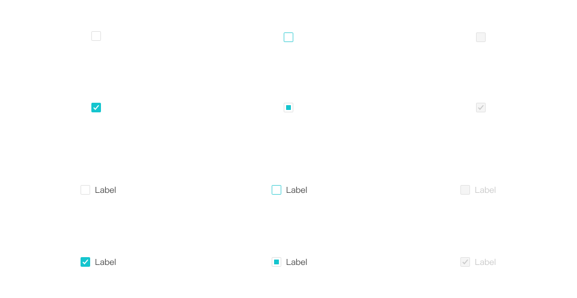

# Checkbox — 10:2274

Referência capturada em **18/10/2026**, usando figma-design-to-code + get_design_context com screenshot, complementada por figma-use somente para leitura de medidas. [Abrir conjunto no Figma](https://www.figma.com/design/ah40tGdCZ8OKiGMkTSB8JO/?node-id=10-2274).

## Tamanho, espaçamento e tipografia

O conjunto tem **12 variantes reais**, sem eixo Size.

| Parte                          | Medida / estilo observado                                    | Exemplo de ID de origem |
| ------------------------------ | ------------------------------------------------------------ | ----------------------- |
| Caixa sem label                | 16 × 16px                                                    | 10:2275; fundo 10:2276  |
| Raio da caixa                  | 2px                                                          | 10:2276                 |
| Borda quando presente          | 1px, alinhada INSIDE                                         | 10:2276                 |
| Conjunto com o texto “Label”   | 60 × 22px; largura dependente do exemplo                     | 10:2281                 |
| Label                          | PingFang SC Regular, peso 400; 14px / 22px; letterSpacing 0% | 10:2283                 |
| Estilo do label                | Regular/Body; S:446791ac1423423ea7b86ed48413afbc69e6c0ee,    | 10:2283                 |
| Distância caixa–label          | 8px; label começa em x=24px                                  | 10:2281                 |
| Alinhamento vertical com label | Caixa em y=3px dentro da linha de 22px                       | 10:2282                 |
| Slot do check                  | 10 × 10px, x=3px, y=3px                                      | 10:2280                 |
| Vetor do check dentro do slot  | Aproximadamente 9,571 × 8,445px; x=0,236px, y=0,717px        | I10:2280;297:23244      |
| Marcador indeterminado         | Quadrado 8 × 8px, x/y=4px, raio 1px                          | 10:2292                 |

O estado indeterminado é desenhado com um quadrado preenchido, e não um traço. SVGs do check mantêm seus width/height originais; não houve redesenho.

## Cores e estados

| Estado              | Fundo da caixa | Borda                | Indicador        | Label   |
| ------------------- | -------------- | -------------------- | ---------------- | ------- |
| Normal, desmarcado  | #FFFFFF        | #E1E1E1              | —                | #4B4B4B |
| Normal, marcado     | #15C5CE        | Sem strokes pintados | Check #FFFFFF    | #4B4B4B |
| Hover, desmarcado   | #FFFFFF        | #47CFD6              | —                | #4B4B4B |
| Indeterminate       | #FFFFFF        | #E1E1E1              | Quadrado #15C5CE | #4B4B4B |
| Disable, desmarcado | #F5F5F5        | #E1E1E1              | —                | #CACACA |
| Disable, marcado    | #F5F5F5        | #E1E1E1              | Check #CACACA    | #CACACA |

Estilos retornados: Black & White/White=#FFFFFF; Neutral/100=#F5F5F5; Neutral/300=#E1E1E1; Neutral/400=#CACACA; Neutral/600=#4B4B4B; Primary/500=#47CFD6; Primary/600=#15C5CE. Não foram observados efeitos/sombras pintados nessas variantes.

## Matriz completa por ID

| ID Figma                                                                        | With label | Checked | Status        | Bounds px | Fundo   | Borda             | Indicador             | Label   |
| ------------------------------------------------------------------------------- | ---------- | ------- | ------------- | --------- | ------- | ----------------- | --------------------- | ------- |
| [10:2275](https://www.figma.com/design/ah40tGdCZ8OKiGMkTSB8JO/?node-id=10-2275) | false      | false   | Normal        | 16 × 16   | #ffffff | #e1e1e1           | —                     | —       |
| [10:2277](https://www.figma.com/design/ah40tGdCZ8OKiGMkTSB8JO/?node-id=10-2277) | false      | true    | Normal        | 16 × 16   | #15c5ce | Sem borda pintada | Slot 10 × 10; #ffffff | —       |
| [10:2281](https://www.figma.com/design/ah40tGdCZ8OKiGMkTSB8JO/?node-id=10-2281) | true       | false   | Normal        | 60 × 22   | #ffffff | #e1e1e1           | —                     | #4b4b4b |
| [10:2284](https://www.figma.com/design/ah40tGdCZ8OKiGMkTSB8JO/?node-id=10-2284) | true       | true    | Normal        | 60 × 22   | #15c5ce | Sem borda pintada | Slot 10 × 10; #ffffff | #4b4b4b |
| [10:2287](https://www.figma.com/design/ah40tGdCZ8OKiGMkTSB8JO/?node-id=10-2287) | false      | false   | Hover         | 16 × 16   | #ffffff | #47cfd6           | —                     | —       |
| [10:2289](https://www.figma.com/design/ah40tGdCZ8OKiGMkTSB8JO/?node-id=10-2289) | false      | true    | Indeterminate | 16 × 16   | #ffffff | #e1e1e1           | 8 × 8; #15c5ce        | —       |
| [10:2293](https://www.figma.com/design/ah40tGdCZ8OKiGMkTSB8JO/?node-id=10-2293) | true       | false   | Hover         | 60 × 22   | #ffffff | #47cfd6           | —                     | #4b4b4b |
| [10:2296](https://www.figma.com/design/ah40tGdCZ8OKiGMkTSB8JO/?node-id=10-2296) | true       | true    | Indeterminate | 60 × 22   | #ffffff | #e1e1e1           | 8 × 8; #15c5ce        | #4b4b4b |
| [10:2299](https://www.figma.com/design/ah40tGdCZ8OKiGMkTSB8JO/?node-id=10-2299) | false      | false   | Disable       | 16 × 16   | #f5f5f5 | #e1e1e1           | —                     | —       |
| [10:2301](https://www.figma.com/design/ah40tGdCZ8OKiGMkTSB8JO/?node-id=10-2301) | false      | true    | Disable       | 16 × 16   | #f5f5f5 | #e1e1e1           | Slot 10 × 10; #cacaca | —       |
| [10:2305](https://www.figma.com/design/ah40tGdCZ8OKiGMkTSB8JO/?node-id=10-2305) | true       | false   | Disable       | 60 × 22   | #f5f5f5 | #e1e1e1           | —                     | #cacaca |
| [10:2308](https://www.figma.com/design/ah40tGdCZ8OKiGMkTSB8JO/?node-id=10-2308) | true       | true    | Disable       | 60 × 22   | #f5f5f5 | #e1e1e1           | Slot 10 × 10; #cacaca | #cacaca |

Checked=true + Status=Indeterminate é o nome exato no Figma. Isso registra aparência, não define a API ou semântica do futuro controle. Não existem variantes separadas de foco, pressed, hover marcado ou indeterminado desabilitado neste conjunto. Essas lacunas não foram preenchidas por suposição.

## Arquivos preservados

- [context.json](context.json): todos os blocos de texto originais de get_design_context, sem resumo. O bloco de imagem aponta para screenshot.png, que conserva os bytes originais.
- [reference-code.txt](reference-code.txt): código de referência retornado pela ferramenta, salvo como texto de documentação; apenas o prefixo dos assets foi trocado por ./assets. A versão original, inclusive URLs temporárias de origem, continua no context.json para rastreabilidade.
- [measurements.json](measurements.json): geometrias por ID, hierarquia por parentId, preenchimentos, bordas, efeitos e segmentos tipográficos; estilos repetidos são deduplicados em profiles.
- [assets.json](assets.json): símbolos do contexto, URLs de origem, caminhos locais e IDs dos slots que usam cada SVG.
- [screenshot.png](screenshot.png): captura retornada na consulta inicial. As dimensões do PNG podem ser reduzidas em relação ao canvas; medidas de componentes vêm do Plugin API, em px lógicos.

Em measurements.json, cada linha de layers segue layerColumns. x/y são relativos ao pai; no nó raiz de cada variante, são relativos ao conjunto de componentes. profileIndex referencia profiles por índice a partir de zero. textSegments guarda [início, fim, índice do perfil tipográfico]. Layout, quando presente, segue [direção, gap, paddingTop, paddingRight, paddingBottom, paddingLeft, alinhamento principal, alinhamento transversal]. Apenas fills/strokes visíveis pintam; strokeWeight sem strokes não implica borda visível. MIXED indica valores diferentes entre segmentos; consultar textSegments em vez de supor um único estilo.

Os IDs originais, inclusive os de instâncias como I…;…, foram preservados. Nomes de variantes de Input foram associados por ID aos data-node-id/data-name do contexto para reduzir a resposta da extração; não foram inventados estados ausentes.

## Escopo

Todos os estados existentes do conjunto foram registrados. O código de referência recebido usa div/button em partes do protótipo e não representa uma implementação funcional de checkbox; nenhuma API, comportamento ou componente foi criado nesta etapa.
