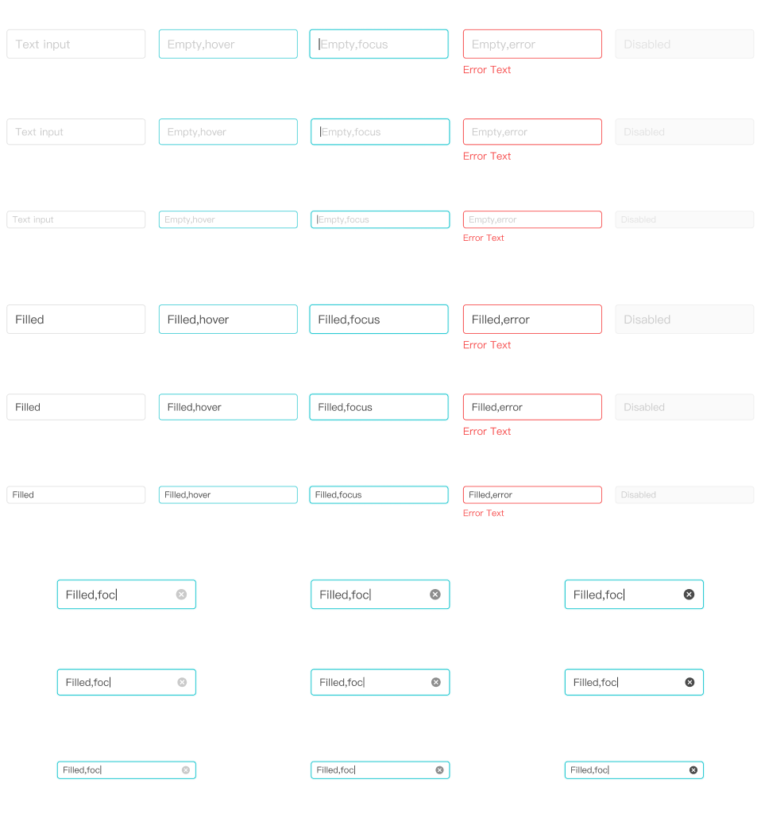

# Input Basic — 11:7949

Referência capturada em **18/10/2026**, usando figma-design-to-code + get_design_context com screenshot, complementada por figma-use somente para leitura de medidas. [Abrir conjunto no Figma](https://www.figma.com/design/ah40tGdCZ8OKiGMkTSB8JO/?node-id=11-7949).

## Tamanhos e geometria

Há **39 variantes reais**. As cinco propriedades não formam um produto cartesiano completo; a tabela abaixo registra exatamente as combinações existentes.

| Tamanho | Largura no exemplo | Altura do controle | Raio | Borda interna | Recuo horizontal do texto | Caixa de linha / recuo vertical observado | Ícone limpar                   |
| ------- | ------------------ | ------------------ | ---- | ------------- | ------------------------- | ----------------------------------------- | ------------------------------ |
| Large   | 190px              | 40px               | 4px  | 1px           | 12px                      | 24px / 8px                                | slot 16 × 16px; 12px à direita |
| Medium  | 190px              | 36px               | 4px  | 1px           | 12px                      | 22px / 7px                                | slot 14 × 14px; 12px à direita |
| Small   | 190px              | 24px               | 4px  | 1px           | 8px                       | 18px / 3px                                | slot 12 × 12px; 8px à direita  |

Os recuos são obtidos da posição das camadas, não de padding de um input HTML existente. A largura de 190px é a largura desenhada, sem evidência de que seja um limite obrigatório do futuro componente. As alturas diferem das min-heights atuais de Button (48/40/32px); esta captura não altera esse contrato.

Com ícone limpar, a caixa de texto termina 36/34/24px antes da borda direita, respectivamente; isso reserva 8/8/4px entre texto e slot. O vetor dentro do slot ocupa aproximadamente 14,667/12,833/11px, com recuos de 0,667/0,583/0,5px. Ver IDs dos slots em assets.json.

## Cores e estados

| Parte / estado                    | Cor                         | Estilo retornado                        |
| --------------------------------- | --------------------------- | --------------------------------------- |
| Fundo normal, hover, foco e erro  | #FFFFFF                     | Black & White/White                     |
| Borda Default                     | #E1E1E1                     | Neutral/300                             |
| Borda Hover                       | #47CFD6                     | Primary/500                             |
| Borda Pressed & Focus             | #15C5CE                     | Primary/600                             |
| Borda e mensagem Error            | #F64C4C                     | Danger/600                              |
| Fundo Disabled                    | #FAFAFA                     | Neutral/50                              |
| Borda Disabled                    | #EEEEEE                     | Neutral/200                             |
| Placeholder                       | #CACACA                     | Neutral/400                             |
| Texto preenchido                  | #4B4B4B                     | Neutral/600                             |
| Texto Disabled vazio              | #E1E1E1                     | Neutral/300                             |
| Texto Disabled preenchido         | #CACACA                     | Neutral/400                             |
| Cursor ilustrado no texto de foco | #1F1F1F                     | Cor extraída dos segmentos              |
| Limpar: normal / hover / pressed  | #CACACA / #8E8E8E / #4B4B4B | Neutral/400 / Neutral/500 / Neutral/600 |

Em Pressed & Focus, a base tem DROP_SHADOW com offset 0/0, blur 1px, spread 1px e #15C5CE a aproximadamente 16%: equivalente visual de `0 0 1px 1px rgba(21, 197, 206, 0.16)`. O JSON preserva os valores de ponto flutuante retornados. Nenhum efeito de foco foi observado nos outros estados.

A camada do ícone limpar recebe o nome “Error” no arquivo, mas aparece em Typing/State 2 nos estados de foco; o nome da camada não significa erro de validação. O caractere “|” simula o cursor no desenho e não deve ser confundido com conteúdo do campo.

## Tipografia e ajuda de erro

Fonte observada: **PingFang SC, Regular, peso 400**, espaçamento entre letras 0% (0 no contexto), opacidade 1.

| Uso                          | Estilo Figma     | Tamanho / entrelinha | ID do estilo                                |
| ---------------------------- | ---------------- | -------------------- | ------------------------------------------- |
| Texto Large                  | Regular/Subtitle | 16/24px              | S:e9f45c7db9715af6563ec4bf672f6560e1aedc01, |
| Texto Medium                 | Regular/Body     | 14/22px              | S:446791ac1423423ea7b86ed48413afbc69e6c0ee, |
| Texto Small                  | Regular/Caption  | 12/18px              | S:45500946a1f869d34f79f87a878cbdd45acd3b3d, |
| Ajuda de erro Large e Medium | Regular/Body     | 14/22px              | S:446791ac1423423ea7b86ed48413afbc69e6c0ee, |
| Ajuda de erro Small          | Regular/Caption  | 12/18px              | S:45500946a1f869d34f79f87a878cbdd45acd3b3d, |

A ajuda começa 4px abaixo do controle: y=44/40/28px nos tamanhos Large/Medium/Small. As alturas das variantes continuam sendo 40/36/24px; a ajuda ultrapassa esses bounds e o conjunto visual completo mede 66/62/46px de altura. Não calcular o espaço ocupado por erro apenas pela altura da variante.

## Matriz completa por ID

True/False reproduzem os eixos originais. Typing=True aparece junto de Text Entered=False em parte das variantes, mesmo com texto “Filled,foc”; é uma convenção/inconsistência do arquivo, preservada como evidência.

| ID Figma                                                                        | Size   | State           | Typing | Text Entered | State 2        | Bounds px | Fundo   | Borda   | Cores do texto/cursor | Texto px |
| ------------------------------------------------------------------------------- | ------ | --------------- | ------ | ------------ | -------------- | --------- | ------- | ------- | --------------------- | -------- |
| [11:7950](https://www.figma.com/design/ah40tGdCZ8OKiGMkTSB8JO/?node-id=11-7950) | Medium | Default         | False  | False        | Not Applicable | 190 × 36  | #ffffff | #e1e1e1 | #cacaca               | 14/22    |
| [11:7953](https://www.figma.com/design/ah40tGdCZ8OKiGMkTSB8JO/?node-id=11-7953) | Small  | Default         | False  | False        | Not Applicable | 190 × 24  | #ffffff | #e1e1e1 | #cacaca               | 12/18    |
| [11:7956](https://www.figma.com/design/ah40tGdCZ8OKiGMkTSB8JO/?node-id=11-7956) | Large  | Error           | False  | False        | Not Applicable | 190 × 40  | #ffffff | #f64c4c | #cacaca               | 16/24    |
| [11:7961](https://www.figma.com/design/ah40tGdCZ8OKiGMkTSB8JO/?node-id=11-7961) | Large  | Error           | False  | True         | Not Applicable | 190 × 40  | #ffffff | #f64c4c | #4b4b4b               | 16/24    |
| [11:7966](https://www.figma.com/design/ah40tGdCZ8OKiGMkTSB8JO/?node-id=11-7966) | Medium | Error           | False  | True         | Not Applicable | 190 × 36  | #ffffff | #f64c4c | #4b4b4b               | 14/22    |
| [11:7971](https://www.figma.com/design/ah40tGdCZ8OKiGMkTSB8JO/?node-id=11-7971) | Small  | Error           | False  | True         | Not Applicable | 190 × 24  | #ffffff | #f64c4c | #4b4b4b               | 12/18    |
| [11:7976](https://www.figma.com/design/ah40tGdCZ8OKiGMkTSB8JO/?node-id=11-7976) | Medium | Error           | False  | False        | Not Applicable | 190 × 36  | #ffffff | #f64c4c | #cacaca               | 14/22    |
| [11:7981](https://www.figma.com/design/ah40tGdCZ8OKiGMkTSB8JO/?node-id=11-7981) | Small  | Error           | False  | False        | Not Applicable | 190 × 24  | #ffffff | #f64c4c | #cacaca               | 12/18    |
| [11:7986](https://www.figma.com/design/ah40tGdCZ8OKiGMkTSB8JO/?node-id=11-7986) | Large  | Pressed & Focus | False  | False        | Not Applicable | 190 × 40  | #ffffff | #15c5ce | #1f1f1f + #cacaca     | 16/24    |
| [11:7989](https://www.figma.com/design/ah40tGdCZ8OKiGMkTSB8JO/?node-id=11-7989) | Large  | Pressed & Focus | False  | True         | Not Applicable | 190 × 40  | #ffffff | #15c5ce | #4b4b4b               | 16/24    |
| [11:7992](https://www.figma.com/design/ah40tGdCZ8OKiGMkTSB8JO/?node-id=11-7992) | Large  | Pressed & Focus | True   | False        | Not Applicable | 190 × 40  | #ffffff | #15c5ce | #4b4b4b + #1f1f1f     | 16/24    |
| [11:7996](https://www.figma.com/design/ah40tGdCZ8OKiGMkTSB8JO/?node-id=11-7996) | Medium | Pressed & Focus | True   | False        | Not Applicable | 190 × 36  | #ffffff | #15c5ce | #4b4b4b + #1f1f1f     | 14/22    |
| [11:8000](https://www.figma.com/design/ah40tGdCZ8OKiGMkTSB8JO/?node-id=11-8000) | Small  | Pressed & Focus | True   | False        | Not Applicable | 190 × 24  | #ffffff | #15c5ce | #4b4b4b + #1f1f1f     | 12/18    |
| [11:8004](https://www.figma.com/design/ah40tGdCZ8OKiGMkTSB8JO/?node-id=11-8004) | Large  | Pressed & Focus | True   | False        | Clear Hover    | 190 × 40  | #ffffff | #15c5ce | #4b4b4b + #1f1f1f     | 16/24    |
| [11:8008](https://www.figma.com/design/ah40tGdCZ8OKiGMkTSB8JO/?node-id=11-8008) | Medium | Pressed & Focus | True   | False        | Clear Hover    | 190 × 36  | #ffffff | #15c5ce | #4b4b4b + #1f1f1f     | 14/22    |
| [11:8012](https://www.figma.com/design/ah40tGdCZ8OKiGMkTSB8JO/?node-id=11-8012) | Small  | Pressed & Focus | True   | False        | Clear Hover    | 190 × 24  | #ffffff | #15c5ce | #4b4b4b + #1f1f1f     | 12/18    |
| [11:8016](https://www.figma.com/design/ah40tGdCZ8OKiGMkTSB8JO/?node-id=11-8016) | Large  | Pressed & Focus | True   | True         | Clear Pressed  | 190 × 40  | #ffffff | #15c5ce | #4b4b4b + #1f1f1f     | 16/24    |
| [11:8020](https://www.figma.com/design/ah40tGdCZ8OKiGMkTSB8JO/?node-id=11-8020) | Medium | Pressed & Focus | True   | True         | Clear Pressed  | 190 × 36  | #ffffff | #15c5ce | #4b4b4b + #1f1f1f     | 14/22    |
| [11:8024](https://www.figma.com/design/ah40tGdCZ8OKiGMkTSB8JO/?node-id=11-8024) | Small  | Pressed & Focus | True   | True         | Clear Pressed  | 190 × 24  | #ffffff | #15c5ce | #4b4b4b + #1f1f1f     | 12/18    |
| [11:8028](https://www.figma.com/design/ah40tGdCZ8OKiGMkTSB8JO/?node-id=11-8028) | Medium | Pressed & Focus | False  | True         | Not Applicable | 190 × 36  | #ffffff | #15c5ce | #4b4b4b               | 14/22    |
| [11:8031](https://www.figma.com/design/ah40tGdCZ8OKiGMkTSB8JO/?node-id=11-8031) | Small  | Pressed & Focus | False  | True         | Not Applicable | 190 × 24  | #ffffff | #15c5ce | #4b4b4b               | 12/18    |
| [11:8034](https://www.figma.com/design/ah40tGdCZ8OKiGMkTSB8JO/?node-id=11-8034) | Medium | Pressed & Focus | False  | False        | Not Applicable | 190 × 36  | #ffffff | #15c5ce | #1f1f1f + #cacaca     | 14/22    |
| [11:8037](https://www.figma.com/design/ah40tGdCZ8OKiGMkTSB8JO/?node-id=11-8037) | Small  | Pressed & Focus | False  | False        | Not Applicable | 190 × 24  | #ffffff | #15c5ce | #1f1f1f + #cacaca     | 12/18    |
| [11:8040](https://www.figma.com/design/ah40tGdCZ8OKiGMkTSB8JO/?node-id=11-8040) | Large  | Hover           | False  | False        | Not Applicable | 190 × 40  | #ffffff | #47cfd6 | #cacaca               | 16/24    |
| [11:8043](https://www.figma.com/design/ah40tGdCZ8OKiGMkTSB8JO/?node-id=11-8043) | Large  | Hover           | False  | True         | Not Applicable | 190 × 40  | #ffffff | #47cfd6 | #4b4b4b               | 16/24    |
| [11:8046](https://www.figma.com/design/ah40tGdCZ8OKiGMkTSB8JO/?node-id=11-8046) | Medium | Hover           | False  | True         | Not Applicable | 190 × 36  | #ffffff | #47cfd6 | #4b4b4b               | 14/22    |
| [11:8049](https://www.figma.com/design/ah40tGdCZ8OKiGMkTSB8JO/?node-id=11-8049) | Small  | Hover           | False  | True         | Not Applicable | 190 × 24  | #ffffff | #47cfd6 | #4b4b4b               | 12/18    |
| [11:8052](https://www.figma.com/design/ah40tGdCZ8OKiGMkTSB8JO/?node-id=11-8052) | Medium | Hover           | False  | False        | Not Applicable | 190 × 36  | #ffffff | #47cfd6 | #cacaca               | 14/22    |
| [11:8055](https://www.figma.com/design/ah40tGdCZ8OKiGMkTSB8JO/?node-id=11-8055) | Small  | Hover           | False  | False        | Not Applicable | 190 × 24  | #ffffff | #47cfd6 | #cacaca               | 12/18    |
| [11:8058](https://www.figma.com/design/ah40tGdCZ8OKiGMkTSB8JO/?node-id=11-8058) | Large  | Disabled        | False  | False        | Not Applicable | 190 × 40  | #fafafa | #eeeeee | #e1e1e1               | 16/24    |
| [11:8061](https://www.figma.com/design/ah40tGdCZ8OKiGMkTSB8JO/?node-id=11-8061) | Large  | Disabled        | False  | True         | Not Applicable | 190 × 40  | #fafafa | #eeeeee | #cacaca               | 16/24    |
| [11:8064](https://www.figma.com/design/ah40tGdCZ8OKiGMkTSB8JO/?node-id=11-8064) | Medium | Disabled        | False  | True         | Not Applicable | 190 × 36  | #fafafa | #eeeeee | #cacaca               | 14/22    |
| [11:8067](https://www.figma.com/design/ah40tGdCZ8OKiGMkTSB8JO/?node-id=11-8067) | Small  | Disabled        | False  | True         | Not Applicable | 190 × 24  | #fafafa | #eeeeee | #cacaca               | 12/18    |
| [11:8070](https://www.figma.com/design/ah40tGdCZ8OKiGMkTSB8JO/?node-id=11-8070) | Medium | Disabled        | False  | False        | Not Applicable | 190 × 36  | #fafafa | #eeeeee | #e1e1e1               | 14/22    |
| [11:8073](https://www.figma.com/design/ah40tGdCZ8OKiGMkTSB8JO/?node-id=11-8073) | Small  | Disabled        | False  | False        | Not Applicable | 190 × 24  | #fafafa | #eeeeee | #e1e1e1               | 12/18    |
| [11:8076](https://www.figma.com/design/ah40tGdCZ8OKiGMkTSB8JO/?node-id=11-8076) | Large  | Default         | False  | False        | Not Applicable | 190 × 40  | #ffffff | #e1e1e1 | #cacaca               | 16/24    |
| [11:8079](https://www.figma.com/design/ah40tGdCZ8OKiGMkTSB8JO/?node-id=11-8079) | Large  | Default         | False  | True         | Not Applicable | 190 × 40  | #ffffff | #e1e1e1 | #4b4b4b               | 16/24    |
| [11:8082](https://www.figma.com/design/ah40tGdCZ8OKiGMkTSB8JO/?node-id=11-8082) | Medium | Default         | False  | True         | Not Applicable | 190 × 36  | #ffffff | #e1e1e1 | #4b4b4b               | 14/22    |
| [11:8085](https://www.figma.com/design/ah40tGdCZ8OKiGMkTSB8JO/?node-id=11-8085) | Small  | Default         | False  | True         | Not Applicable | 190 × 24  | #ffffff | #e1e1e1 | #4b4b4b               | 12/18    |

## Arquivos preservados

- [context.json](context.json): todos os blocos de texto originais de get_design_context, sem resumo. O bloco de imagem aponta para screenshot.png, que conserva os bytes originais.
- [reference-code.txt](reference-code.txt): código de referência retornado pela ferramenta, salvo como texto de documentação; apenas o prefixo dos assets foi trocado por ./assets. A versão original, inclusive URLs temporárias de origem, continua no context.json para rastreabilidade.
- [measurements.json](measurements.json): geometrias por ID, hierarquia por parentId, preenchimentos, bordas, efeitos e segmentos tipográficos; estilos repetidos são deduplicados em profiles.
- [assets.json](assets.json): símbolos do contexto, URLs de origem, caminhos locais e IDs dos slots que usam cada SVG.
- [screenshot.png](screenshot.png): captura retornada na consulta inicial. As dimensões do PNG podem ser reduzidas em relação ao canvas; medidas de componentes vêm do Plugin API, em px lógicos.

Em measurements.json, cada linha de layers segue layerColumns. x/y são relativos ao pai; no nó raiz de cada variante, são relativos ao conjunto de componentes. profileIndex referencia profiles por índice a partir de zero. textSegments guarda [início, fim, índice do perfil tipográfico]. Layout, quando presente, segue [direção, gap, paddingTop, paddingRight, paddingBottom, paddingLeft, alinhamento principal, alinhamento transversal]. Apenas fills/strokes visíveis pintam; strokeWeight sem strokes não implica borda visível. MIXED indica valores diferentes entre segmentos; consultar textSegments em vez de supor um único estilo.

Os IDs originais, inclusive os de instâncias como I…;…, foram preservados. Nomes de variantes de Input foram associados por ID aos data-node-id/data-name do contexto para reduzir a resposta da extração; não foram inventados estados ausentes.

## Escopo

Todos os tamanhos e estados existentes neste conjunto foram registrados. Não foram consultados Input com ícones laterais, Number, Prefix/Suffix ou outros componentes. O código de referência é um protótipo visual; não foi incorporado a packages/react, ao playground ou às stories.
