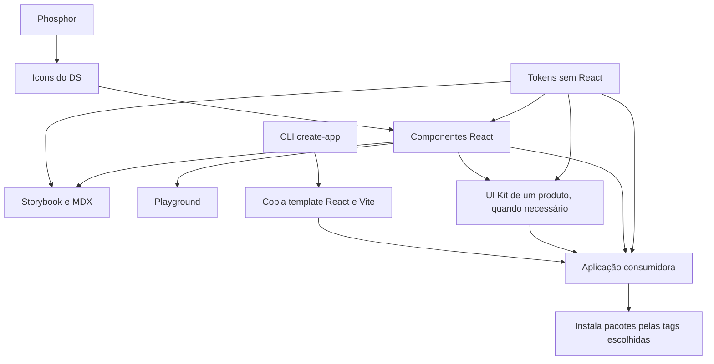

# Arquitetura do Design System

O monorepo usa npm workspaces, React/TypeScript, Emotion e Vite. Os pacotes publicáveis ficam em `packages/`; aplicações de desenvolvimento ficam em `apps/`. As setas abaixo indicam quem fornece código ou artefatos para o próximo bloco.

[Abrir a versão em imagem do diagrama](diagramas/arquitetura.png).

Alternativa textual: tokens não dependem de React. Componentes e consumidores leem esses valores. Icons centraliza o fornecedor de ícones dentro da biblioteca. Storybook e playground consomem o núcleo para documentar e testar seu uso. O create-app copia a estrutura do template para uma aplicação que passa a depender dos pacotes npm; ele não copia cada componente do DS.

## Fronteiras

- **Núcleo:** componentes e valores genéricos úteis a mais de um produto.
- **UI Kit:** composições e identidade de um produto real, em um pacote independente. O núcleo não importa o kit.
- **Aplicação:** rotas, estado de domínio, permissões e integrações com servidor.
- **Documentação:** MDX junto dos componentes para API executável; `docs/gitbook/` para adoção, fundamentos, receitas e decisões.

Não crie um kit apenas para reservar uma pasta. A existência de um produto e a necessidade de reutilizar suas composições orientam essa decisão. React/Emotion continuam peers dos componentes; os consumidores mantêm versões compatíveis.

## Arquivos de um componente

`Component.tsx` contém API e comportamento. `Component.style.ts` contém estilos Emotion e importa tipos do componente com `import type` quando necessário. O diretório também mantém `index.ts`, stories, testes de comportamento e `Component.mdx`, ligado às stories por `Meta of`. Exports públicos são mantidos em `packages/react/src/index.ts`.

Somente `packages/react/src/Icons` importa Phosphor. Button recebe slots ReactNode; exemplos e consumidores usam `Icons` do DS. Assets Figma de Input/Checkbox permanecem preservados.

## Documentação e distribuição

Os exports dos pacotes locais apontam para `dist`, compilado antes de consumir pelo workspace. O CLI distribui um template autocontido; projetos gerados evoluem independentemente. Veja [desenvolvimento local](desenvolvimento-local.md) e [create-app](create-app.md).

O GitBook sincroniza os guias após o merge em sua branch conectada. Publicar npm, fazer deploy do Storybook e sincronizar o GitBook são processos diferentes. Consulte [o fluxo de desenvolvimento](fluxo-desenvolvimento.md) e [versões/publicação](versoes-e-publicacao.md).

O bloco Mermaid acima é o fonte versionado. A imagem é uma exportação de apoio, não uma segunda fonte de arquitetura. Ao alterar o fluxo, atualize o bloco e regenere a imagem; a renderização nativa no GitBook precisa ser conferida após merge.
