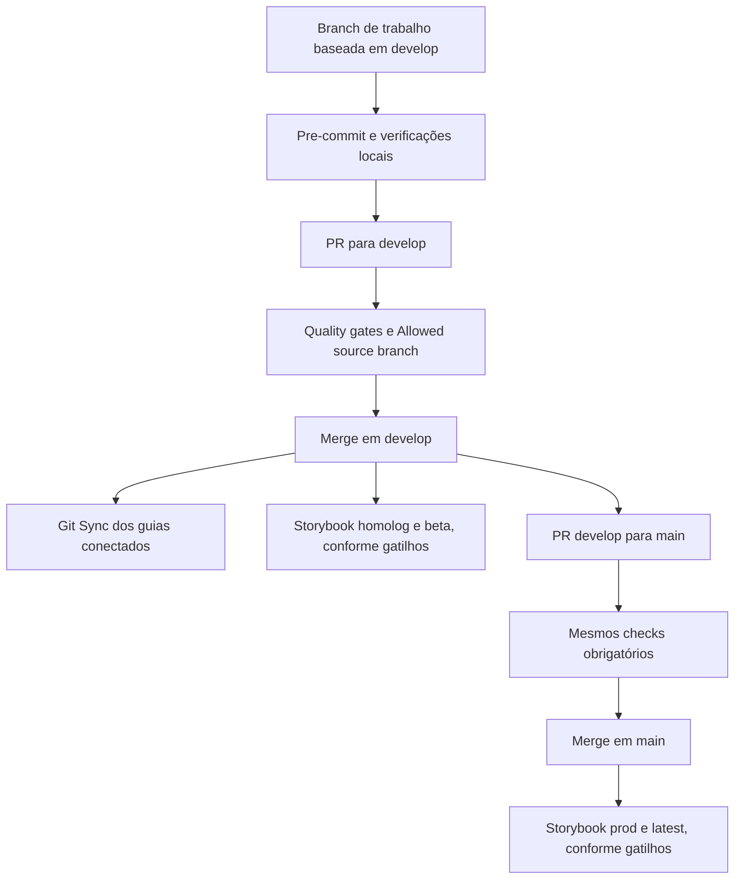

# GitFlow e qualidade

`develop` é a base de trabalho/homologação e `main` representa produção. PRs para `develop` podem vir de uma branch de trabalho; PRs para `main` só podem vir de `develop`.

[Abrir a versão em imagem do diagrama](diagramas/gitflow.png).

Alternativa textual: uma mudança parte de `develop`, passa pelas verificações locais e por uma PR com os dois checks obrigatórios. O merge integra código e documentação em homologação. A promoção para produção é outra PR, de `develop` para `main`, também validada. Os serviços de documentação e publicação respondem aos seus próprios gatilhos e configurações.

## Gates e hooks

O pre-commit roda lint-staged e `npm run check:commit`: testes, stories, lint, formatação e build. O CI executa `npm run ci`, incluindo consumo dos tarballs e os builds estáticos do Storybook. Não há pre-push com a suíte completa.

Na consulta ao GitHub em 20/10/2026, os rulesets de `develop` e `main` estão ativos, sem bypass, com PR obrigatória e os checks **Quality gates** e **Allowed source branch** vinculados ao app GitHub Actions. A branch precisa estar atualizada com a base. Os rulesets também impedem exclusão e force-push; o número de reviews obrigatórias é zero. Isso não elimina a responsabilidade de revisar uma mudança antes de integrá-la.

Confira os comandos reais em [desenvolvimento local](desenvolvimento-local.md). Uma mudança apenas nos guias não exige um changeset de pacote; ainda passa pelo CI da PR.

## Fontes de configuração

- [CI](https://github.com/ArturRibeiro01/art-liz-design-system/blob/develop/.github/workflows/ci.yml).
- [Política de origem](https://github.com/ArturRibeiro01/art-liz-design-system/blob/develop/.github/workflows/pr-branch-policy.yml).
- [Deploy do Storybook](https://github.com/ArturRibeiro01/art-liz-design-system/blob/develop/.github/workflows/deploy-storybook.yml).
- [Rulesets do repositório](https://github.com/ArturRibeiro01/art-liz-design-system/settings/rules).

Cada bloco Mermaid é a fonte da imagem correspondente. Uma exportação renderizada localmente não comprova navegação, busca ou renderização no portal; use a [revisão de manutenção](manutencao.md) após a sincronização.
