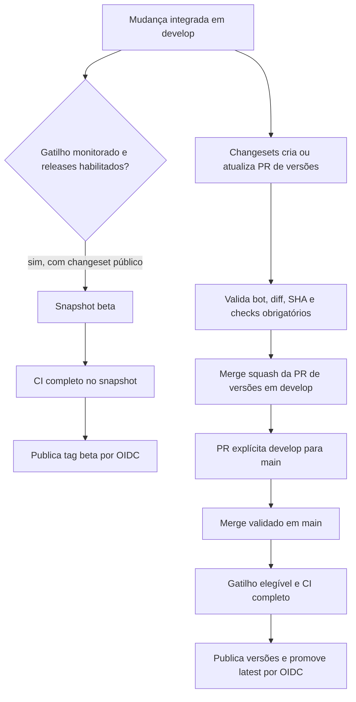

# Versões e publicação

Mudanças publicáveis recebem Changesets. Na branch de trabalho, rode `npm run changeset`, selecione os pacotes afetados e escreva um resumo que descreva o comportamento para quem consome a biblioteca. Versione o arquivo gerado junto da mudança.

Use patch para correções compatíveis, minor para APIs novas compatíveis e major para mudanças incompatíveis. Confira dependentes e o contrato público antes de escolher o incremento. Guias conceituais em `docs/gitbook/` sem mudança no pacote não exigem release npm.



[Abrir a versão em imagem do diagrama](diagramas/releases.png).

Alternativa textual: a alteração funcional pode publicar snapshots beta depois do gate completo. Separadamente, Changesets prepara versões e changelogs em uma PR do bot. Essa PR só recebe merge depois da validação e dos checks obrigatórios. A publicação estável depende de promoção explícita para `main`, dos gatilhos e da habilitação do job, e executa novamente o CI antes de publicar e promover `latest`.

## Beta, stable e recuperação

Os workflows de publicação só executam o job com `NPM_RELEASES_ENABLED` igual a `true`, na branch esperada. Seus filtros de caminhos monitoram changesets, pacotes, manifests/lockfile e a verificação de artefatos. Um merge só nos guias não implica publicar npm.

O beta automático exige changesets públicos pendentes, gera snapshots e publica com a tag `beta`. A PR de versionamento prepara as versões estáveis; o beta não precisa esperar esse merge. Há recuperação manual `publish-current=true` para snapshots de versões atuais ausentes do npm, com as restrições do workflow.

O merge da PR do bot usa GITHUB_TOKEN e pode não disparar outro workflow de push. O fluxo não depende de uma segunda publicação beta por esse evento. A promoção para `main` continua explícita, fora do auto-merge das PRs de versionamento.

## Permissões e aprovações reais

Os jobs npm usam Trusted Publishing/OIDC com `contents: read` e `id-token: write`. Não é necessário NPM_TOKEN. Os environments são `npm-beta` e `npm-production`; os Trusted Publishers do npm precisam corresponder aos workflows/environments e às operações autorizadas.

Na consulta de 20/10/2026, `npm-beta` não tinha regras de proteção e `npm-production` tinha política de branches, sem required reviewers. Não há confirmação de aprovação humana obrigatória no environment atual. A PR para `main` e os checks de branch continuam exigidos; não confundir essa integração explícita com um gate de aprovação do environment.

O job de versionamento tem permissões de escrita para conteúdo/PRs e dispatch de actions, além de leitura dos checks. O auto-merge é restrito ao bot github-actions[bot], branch exata changeset-release/develop, mesmo repositório, destino develop, diff exclusivamente de versionamento e SHA validado. Não cria bypass para PRs comuns.

O workflow stable mantém npm 11.6.2 no CI e usa npm 11.21.0 para a promoção de dist-tags via OIDC. Configurações e credenciais pertencem aos serviços; os guias não devem conter segredos.

## Conferir uma publicação

```sh
npm view @art-liz/tokens dist-tags
npm view @art-liz/react dist-tags
npm view @art-liz/create-app dist-tags
```

Confirme o resultado do workflow e a versão realmente instalada no app. Em caso de falha, preserve logs e corrija a causa antes de repetir o fluxo apropriado; uma versão stable publicada recebe nova correção/versionamento. Consumidores não precisam rodar `changeset version` para atualizar dependências.

Fontes: [beta](https://github.com/ArturRibeiro01/art-liz-design-system/blob/develop/.github/workflows/publish-beta.yml), [stable](https://github.com/ArturRibeiro01/art-liz-design-system/blob/develop/.github/workflows/publish-stable.yml), [PR de versões](https://github.com/ArturRibeiro01/art-liz-design-system/blob/develop/.github/workflows/changesets-version.yml) e [validação do auto-merge](https://github.com/ArturRibeiro01/art-liz-design-system/blob/develop/scripts/release-automerge.mjs). A renderização deste Mermaid no GitBook precisa de revisão após merge; a imagem e o texto preservam o fluxo se o bloco não for exibido.
